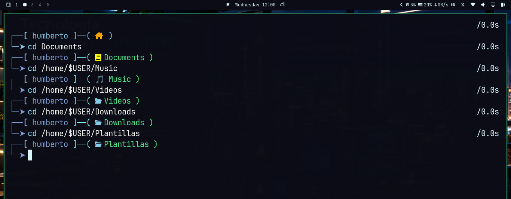

## 📄 `README.md`

Configuración modular de Zsh para Linux.

> **De un `.zshrc` de 5000 líneas a 30 archivos pequeños y mantenibles.**
> Arranque 40 veces más rápido (~2s → ~0.05s).

---

## 📖 ¿Qué es esto?

Una configuración de Zsh **modular, documentada y reproducible**, nacida de migrar un `.zshrc` monolítico de 10 años.

**Filosofía**:

- Cada cosa en su archivo.
- Config separada de lógica.
- Carga diferida (`autoload`) para las funciones.
- Migración **fiel** al original. Solo reorganización.
- Documentación honesta y reproducible a 15 años.

**NO es**:

- Un framework.
- Un gestor de plugins.
- Una distribución de Zsh.

**SÍ es**:

- Una estructura lista para usar en cualquier distro linux.
- Un ejemplo de migración de un `.zshrc` legacy.
- Un proyecto personal documentado.

---

## 🎯 Qué incluye

### Estructura

```
zsh-config/
├── README.md              ← este archivo
├── INSTALL.md             ← guía de instalación detallada
├── LESSONS.md             ← lecciones aprendidas
├── install.sh             ← instalador automático
├── LICENSE                ← MIT
├── .gitignore
│
├── zsh/
│   ├── zshenv             ← bootstrap (ZDOTDIR)
│   ├── zshrc              ← orquestador (renombrar a .zshrc al instalar)
│   ├── conf.d/            ← fragmentos de configuración
│   │   ├── 00-options.zsh
│   │   ├── 10-history.zsh
│   │   ├── 20-path.zsh
│   │   ├── 30-completion.zsh
│   │   ├── 31-compdefs.zsh
│   │   ├── 40-plugins.zsh
│   │   ├── 42-dracula-theme.zsh
│   │   ├── 50-keybindings.zsh
│   │   ├── 60-aliases.zsh
│   │   ├── 70-prompt.zsh
│   │   ├── 80-hooks.zsh
│   │   ├── 90-startup.zsh
│   │   └── aliases.d/
│   │       ├── 00-core.sh
│   │       ├── 05-omarchy-keybindings.sh
│   │       ├── 10-fs.sh
│   │       ├── 20-git.sh
│   │       ├── 30-pacman-yay.sh
│   │       ├── 40-systemd.sh
│   │       ├── 42-services.sh
│   │       ├── 45-pasword-corretion.sh
│   │       ├── 50-clamav.sh
│   │       ├── 60-rclone.sh
│   │       ├── 70-media.sh
│   │       ├── 80-scripts.sh
│   │       ├── 90-misc.sh
│   │       └── 95-func-shortcuts.sh
│   └── functions/         ← funciones con autoload
│       ├── search-aliases
│       ├── nano-script
│       ├── bc-calc
│       ├── zellij-layout
│       ├── clamav-virus
│       ├── HistAI
│       ├── HistAI_Preview
│       ├── _histai_preview
│       ├── mantenimiento
│       ├── ufw-manager
│       ├── menu-principal
│       ├── rmsymlinks
│       ├── checksymlinks
│       ├── suite-watch
│       └── vpn
│
└── scripts/
    └── zsh-backup         ← script de backup/restauración
```

### Módulos

| Módulo | Archivo | Contenido |
|--------|---------|-----------|
| **Opciones** | `00-options.zsh` | `setopt`/`unsetopt` |
| **Historial** | `10-history.zsh` | `HISTSIZE`, `SHARE_HISTORY`, etc. |
| **PATH** | `20-path.zsh` | PATH limpio y deduplicado |
| **Completion** | `30-completion.zsh` | `compinit` con caché |
| **Compdefs** | `31-compdefs.zsh` | Registro de autocompletados |
| **Plugins** | `40-plugins.zsh` | fzf-tab, autosuggestions, syntax-highlighting |
| **Tema** | `42-dracula-theme.zsh` | Colores Dracula |
| **Keybindings** | `50-keybindings.zsh` | Atajos de teclado |
| **Aliases** | `60-aliases.zsh` + `aliases.d/` | 14 archivos por dominio |
| **Prompt** | `70-prompt.zsh` | Prompt dinámico con iconos |
| **Hooks** | `80-hooks.zsh` | `precmd` con `vcs_info` |
| **Startup** | `90-startup.zsh` | Comandos al abrir terminal |

### Funciones (15)

| Función | Qué hace |
|---------|----------|
| `search-aliases` | Busca aliases por palabra clave |
| `nano-script` | Crea scripts desde plantilla (`~/Plantillas/`) |
| `bc-calc` | Calculadora interactiva (basada en `bc`) |
| `zellij-layout` | Gestor de layouts de Zellij |
| `clamav-virus` | Menú interactivo de ClamAV |
| `HistAI` | Búsqueda en historial con fzf |
| `HistAI_Preview` | Igual pero con vista previa |
| `_histai_preview` | Auxiliar de `HistAI_Preview` (genera el preview) |
| `mantenimiento` | Super mantenimiento del sistema (con submenú Omarchy) |
| `ufw-manager` | Gestor interactivo de firewall |
| `menu-principal` | Menú central por secciones con acceso a todo |
| `rmsymlinks` | Borra enlaces simbólicos de un directorio |
| `checksymlinks` | Audita y limpia enlaces rotos |
| `suite-watch` | Diagnóstico del sistema |
| `vpn` | Gestor de conexión Proton VPN |

**Nota**: `zsh-backup` vive en `scripts/` y se instala en `~/.local/bin/`. Es un script independiente, no una función autoload.

---

## 🚀 Instalación rápida

### Opción A: Instalador automático (recomendado)

```bash
bash <(curl -sSL https://codeberg.org/novum-humberto/zsh-config/raw/branch/main/install.sh)
```

El script:
1. Verifica dependencias e instala las que falten.
2. Copia la config a `~/.config/zsh/`.
3. Copia el bootstrap a `~/.zshenv`.
4. Copia `zsh-backup` a `~/.local/bin/`.
5. Configura `menu-principal` con la opción de cryptosith si está disponible.

### Opción B: Clonar e instalar manualmente

```bash
git clone https://codeberg.org/novum-humberto/zsh-config.git
cd zsh-config
./install.sh
```

### Opción C: Instalación manual paso a paso

Ver [`INSTALL.md`](INSTALL.md).

---

## 🔐 Proyectos relacionados

### `cryptosith`

Herramienta de **cifrado por capas** para archivos y directorios.

**No está incluida en este repositorio**. Se distribuye por separado:

- **Repo**: <https://codeberg.org/novum-humberto/cryptosith>
- **Instalación**: ver el `README.md` de ese repo.

Si `menu-principal` no encuentra `cryptosith`, la opción 2 mostrará un aviso.
Si lo instalas después, la opción 2 funcionará automáticamente.

---

## 🧪 Verificación

Después de instalar, abre una terminal nueva y verifica:

```bash
# 1. Zsh carga correctamente
echo $ZDOTDIR
# → /home/tuuser/.config/zsh

# 2. Tiempo de arranque
time zsh -i -c 'exit'
# → ~0.05s

# 3. Funciones registradas
type menu-principal
# → menu-principal is a shell function from ...

# 4. Aliases
alias ls
# → ls='lsd'

# 5. Menú central
menu
```

---

## 🎨 Captura



---

## 📋 Requisitos

- **SO**: Omarchy (Arch Linux + Hyprland) — aunque debería funcionar en cualquier Arch.
- **Shell**: Zsh 5.8+.
- **Paquetes**: ver [`INSTALL.md`](INSTALL.md#dependencias).

**Dependencias principales**:

- `zsh`, `util-linux`, `coreutils`
- `age`, `gnupg`, `p7zip` (para cryptosith)
- `fzf`, `bat`, `lsd`, `fd`, `ripgrep`
- `neovim`, `less`, `openssl`

---

## 🎓 Documentación

- **[INSTALL.md](INSTALL.md)** — guía de instalación detallada, multi-distro.
- **[LESSONS.md](LESSONS.md)** — lecciones aprendidas durante la migración.
- **[manual de cryptosith](https://codeberg.org/novum-humberto/cryptosith)** — en su propio repo.

---

## 🤝 Contribuir

Este es un proyecto **personal**. No espera contribuciones.

Si quieres usarlo: fork, adapta, disfruta.

Si encuentras un bug: abre un issue.

Si quieres sugerir algo: hazlo, pero ten en cuenta que es mi config.

---

## ⚖️ Licencia

MIT. Ver [LICENSE](LICENSE).

---

## 🙏 Agradecimientos

- [Arch Linux](https://archlinux.org) — por el sistema.
- La comunidad de Zsh — por el shell.

---

**Proyecto**: migración de un `.zshrc` de 10 años a una estructura modular.
**Estado**: funcional, documentado, en uso diario.
**Reproducible**: dentro de 15 años, si alguien quiere.


